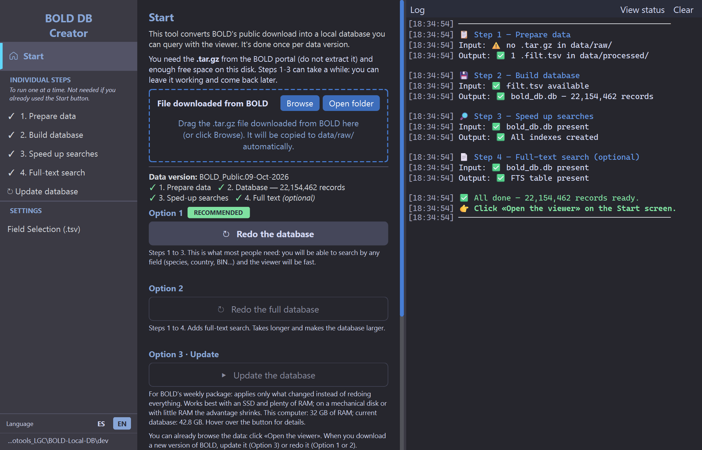
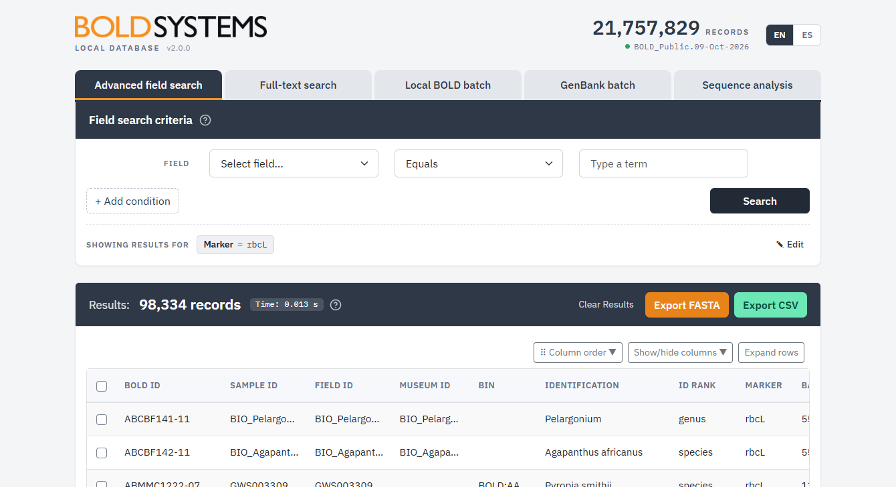
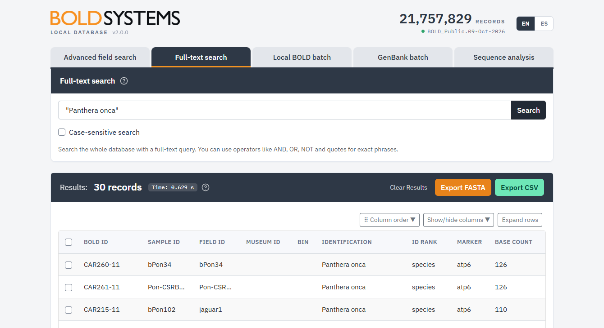
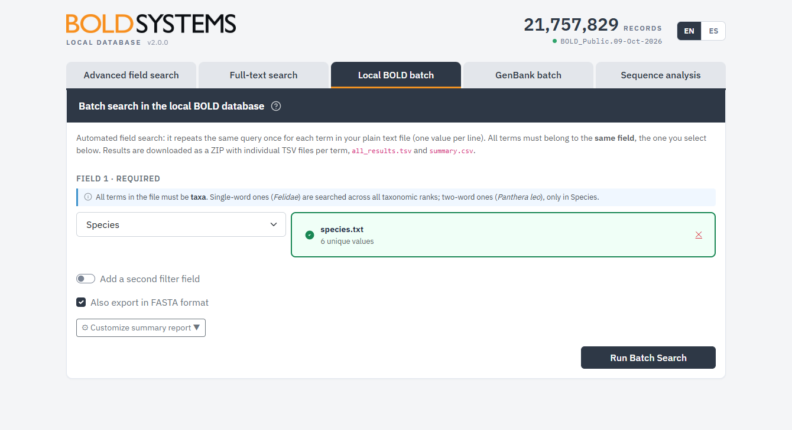
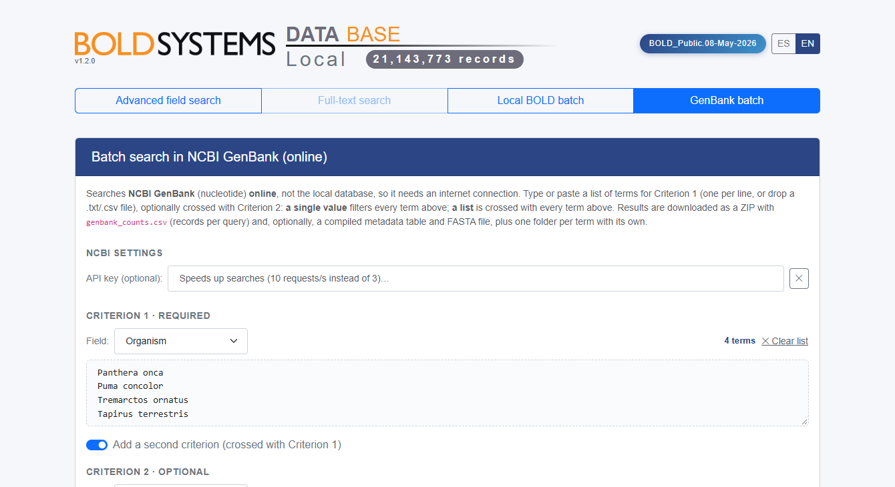
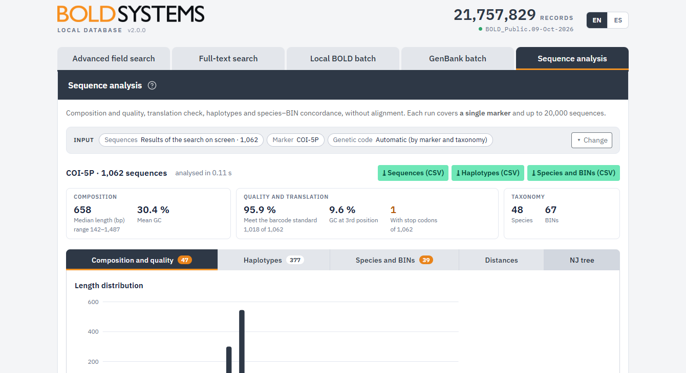
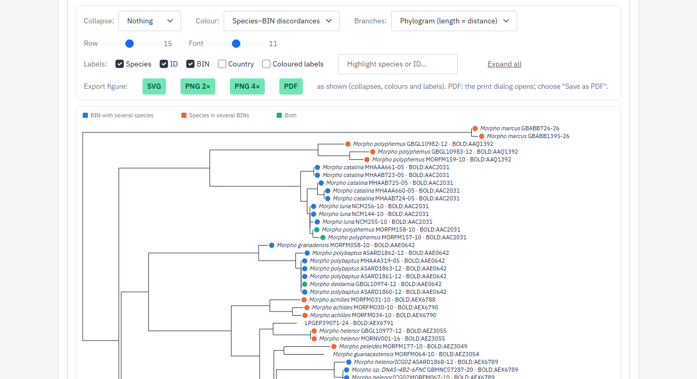

# BOLD-Local-DB

**Version: 2.5.0**

Desktop tool to build and browse a local, **offline** SQLite database from
[BOLD Systems](https://www.boldsystems.org/) (Barcode of Life Data System) TSV exports.

## What it does

Two programs, used in order:

1. **BOLD-Local-DB / Creator** (`dev/bold_db_creator.py`) — filters the raw BOLD
   TSV/`tar.gz` export, loads it into SQLite, indexes the selected fields and
   builds full-text search.

   > **Note:** only records with a DNA sequence (`nuc` field) are kept —
   > records without a sequence are discarded during Step 1 (TSV filtering)
   > and never make it into the SQLite database.
   > That explains the difference in the number of records between the platform database and the local database.
2. **Web viewer** (`dev/frontend/server.py`) — local Flask web app to search,
   filter and export records (CSV / FASTA) from the database. Works fully
   offline once the database exists.

   It also has a **GenBank batch** tab (ported from BarcodeSuite) that
   searches NCBI GenBank online — the only feature that needs internet — for
   a list of terms, optionally crossed with a second criterion, and downloads
   a ZIP with record counts per query and, optionally, metadata (TSV) and
   sequences (FASTA).

   The **Sequence analysis** tab checks the sequences of a search, of the
   checked records or of a FASTA file, one marker per run: composition and
   quality, stop codons, haplotypes, species–BIN concordance and, on demand,
   K2P distances, barcode gap, a neighbour-joining tree, species
   delimitation (ASAP and ABGD) compared with the names and BINs, and
   haplotype networks (TCS and MSN). Each panel
   has a help icon that opens the user guide at its section.

### Screenshots

**Creator** — builds and updates the database



**Web viewer**

| Advanced field search | Full-text search |
|---|---|
|  |  |
| **Local BOLD batch** | **GenBank batch** |
|  |  |
| **Sequence analysis** | **NJ tree (species–BIN discordances)** |
|  |  |

## Requirements

- Windows, macOS or Linux. Nothing else to install: the first start downloads
  its own Python and packages (about 150 MB, once) into the program's folder.
- A [BOLD Systems](https://bench.boldsystems.org/) account, to download data packages
- ~80 GB of free disk space, for the downloaded package and the resulting database.
  Rebuilding over an existing database needs room for a second copy: the new
  one is built next to the current one and replaces it when it's finished.

## Quick start

1. Download the zip for your system from
   [Releases](https://github.com/etovarluque/BOLD-Local-DB/releases/latest)
   (`BOLD-Local-DB-windows.zip`, `-macos.zip` or `-linux.zip`) and unpack it
   wherever you like.
2. Open **Start BOLD-Local-DB** in the unpacked folder (`.bat` on Windows,
   `.command` on macOS, `.sh` on Linux). The first time it downloads its
   components, which takes a few minutes; then the program opens and offers
   to create shortcuts on the desktop and in the menu:
   - **BOLD-Local-DB**: the program, to build or update the database.
   - **BOLD-Local-DB Viewer**: the viewer, straight in the browser
     (`http://127.0.0.1:5001`).
3. Download a data package (`.tar.gz`) from
   [BOLD Systems — Data Packages](https://bench.boldsystems.org/index.php/datapackages/Latest),
   drop it on the Home screen and choose **Option 1 · Create the database**.

**First-run OS quirks:**
- **macOS**: Gatekeeper blocks a downloaded `.command` the first time:
  right-click *Start BOLD-Local-DB.command* → *Open* → *Open*. Only once; the
  shortcuts the program makes afterwards aren't affected.
- **Linux**: if double-clicking the `.sh` opens it in a text editor, allow
  running executable files in your file manager or run it from a terminal.
  The shortcuts the program makes are marked as trusted.

The shortcuts can be removed or made again from the Home screen. If the
folder is moved, the program remakes them on its next start.

### Updating the program

When a new version is out, the Home screen says so. **Update** downloads it
and restarts the program with it: only the program is replaced, never
`data/` (database, exports, field selection). If the new version fails to
start, the launcher puts the previous one back.

### Uninstalling

**Uninstall…** on the Home screen removes the shortcuts and opens the folder
holding the program, for you to delete it. Apart from the shortcuts, the
program keeps everything inside its folder: its Python and packages are in
`.runtime/`, nothing is installed on the system.

### Coming from 1.2.0 or earlier

Unpack the new zip and copy what's inside its `BOLD-Local-DB` folder
(including the hidden `.program`) **into your current folder**, then open
*Start BOLD-Local-DB* there. On its first start the program moves the database, logs and
settings from `app/` into `data/`, keeps your field selection, and removes
the old launch scripts, shortcuts and the `dev/` folder. Make the shortcuts
again from the Home screen.

## Weekly updates

BOLD publishes a full new data package every week. Once a database exists,
there's no need to rebuild it from scratch: drop the new `.tar.gz` on the
Home screen and choose **Option 3 · Update the database**. It prepares the
new package (Step 1), compares it with the current database record by record
and applies only what's new, modified or removed; indexes and full-text
search are kept up to date along the way, so Steps 3 and 4 (most of a
rebuild's time) aren't repeated.

How much faster it is depends on the machine: with an SSD and enough RAM for
the indexes to fit, an update takes a fraction of a rebuild; on a mechanical
disk or with little RAM the gain shrinks. The Home screen shows the
computer's RAM next to the database size so you can choose. If more than 10%
of the records changed, the update stops without modifying anything and
recommends a rebuild. A failed or stopped update leaves the database exactly
as it was, and the viewer keeps working while it runs.

## Project structure

What a user sees after unpacking a release:

```
BOLD-Local-DB/
├── Start BOLD-Local-DB.bat / .command / .sh   # the only thing to open
├── guide/                     # user guide (ES/EN)
├── data/                      # everything that's yours; updates never touch it
│   ├── raw/                   # BOLD's .tar.gz goes here
│   ├── processed/             # Step 1's output
│   ├── exports/               # what the viewer exports
│   ├── database/              # bold_db.db
│   └── state/                 # settings, logs, field selection, shortcuts made
├── .program/                  # the program (dev/ in this repository); replaced by updates
└── .runtime/                  # uv, its Python and the packages; made by the launcher
```

`.program/` and `.runtime/` are hidden (a leading dot on macOS/Linux, the
hidden attribute on Windows). Deleting `.runtime/` only costs a new download.

This repository:

```
├── Start BOLD-Local-DB.bat / .command / .sh   # launchers (they use dev/ when there's no .program/)
├── dev/
│   ├── start.py               # what the launchers run: updates, migration, shortcuts, then the program
│   ├── bold_db_creator.py     # the program: Home, Steps 1-4, field selection
│   ├── shortcuts.py           # desktop/menu shortcuts per OS
│   ├── updater.py             # updates from GitHub Releases
│   ├── bootstrap/             # downloads uv (pinned version, checksum verified)
│   ├── pyproject.toml, uv.lock, .python-version   # packages, installed by uv
│   ├── fields_config.json     # default field selection
│   ├── icons/
│   ├── tools/build_release.py # builds the per-OS zips
│   ├── frontend/
│   │   ├── server.py          # the viewer (Flask)
│   │   ├── layout.py          # where everything lives; migration from app/
│   │   ├── db_contract.py     # what the Creator writes and the viewer reads
│   │   ├── genbank_batch.py, seq_analysis.py, seq_distance.py, seq_identify.py
│   │   ├── static/
│   │   └── templates/
│   └── screenshots/
├── guide/
└── .github/workflows/         # release.yml (publishes the zips), launcher-check.yml
```

### Development

Clone the repository and open the launcher for your system: it uses `dev/`
directly. Or, with [uv](https://docs.astral.sh/uv/) installed:

```
uv run --project dev python dev/start.py            # the program
uv run --project dev python dev/start.py --viewer   # the viewer
```

After changing the packages in `dev/pyproject.toml`, run `uv lock` in `dev/`.
In a clone the program doesn't update itself (use `git pull`) and doesn't ask
about shortcuts.

### Releasing

Set the version in `dev/frontend/db_contract.py` (`APP_VERSION`) and
`dev/pyproject.toml`, add its section to `CHANGELOG.md`, then:

```
git tag v1.3.0 && git push --tags
```

`.github/workflows/release.yml` builds the three zips and publishes the
release with that CHANGELOG section as notes; copies already installed
offer the update from then on.

## Documentation

- [Guía de uso (ES)](guide/guia_de_uso.html)
- [User guide (EN)](guide/user_guide.html)

## License

[Polyform Noncommercial 1.0.0](LICENSE) — free to use, modify and redistribute
for any noncommercial purpose. Commercial use (selling it, offering it as a
paid service, etc.) is not permitted.
